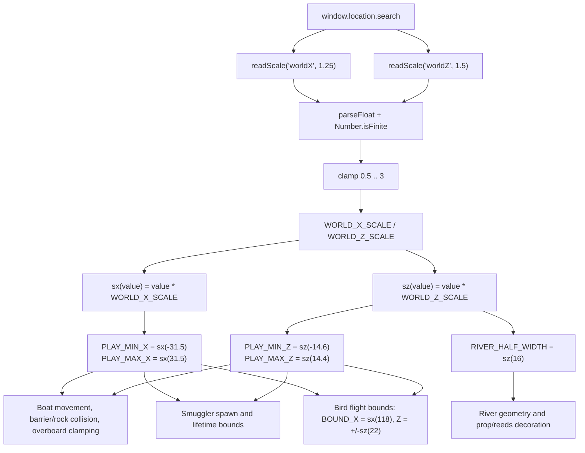

# 03 — Widen play area

Source: `src/world/Bounds.ts`. Consumers include `src/world/River.js`, `src/entities/Boat.js`, `src/entities/Birds.js`, `src/entities/SmugglerManager.js`, and `src/main.js`.

## Logic

1. Read `?worldX=` and `?worldZ=` from the URL, falling back to 1.25 (125% long) and 1.5 (150% wide).
2. Reject non-finite values and clamp valid values to `0.5 .. 3`.
3. Export the scales plus `sx`/`sz` helpers; every world position, gameplay limit, river width, and spawn range derives from them.
4. Changing the defaults or URL parameters rescales the whole play area in sync without touching individual systems.
