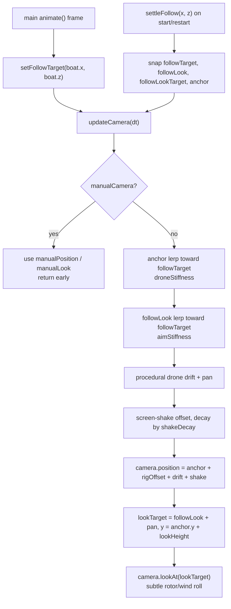

# 04 — Camera rubberband / follow

Source: `src/core/Renderer.ts`, driven from `src/main.js`.

## Logic

- `setFollowTarget` only receives the boat's current position; there is no velocity feed-forward, so the drone cannot predict the next turn.
- The drone body (`anchor`) follows promptly via `droneStiffness`; the gimbal (`followLook`) trails farther behind via `aimStiffness` and then eases in when the boat slows or stops.
- Exponential smoothing (`1 - exp(-dt * stiffness)`) keeps the trail frame-rate independent and removes the old rubberband overshoot.
- Procedural drift, lazy pan, and rotor roll keep the shot alive without touching the gameplay follow.
- `settleFollow` snaps all camera vectors on start/restart so the camera never sweeps in from an old position.
- Game over reuses `manualCamera`: `main.js` eases a target-lock pose and a 50° horizontal FOV override onto the crash/breach point while `state === 'GAMEOVER'` (see [13-game-over.md](13-game-over.md)).
- Tuning overrides: `?y=`, `?look=`, `?fov=`, `?aim=`, `?drone=`.
- On tall screens the rig yaws 90° about the follow point and the target is shifted by a lead along screen-up; see [36-portrait-mode.md](36-portrait-mode.md).

## Decisions

- **Decision:** Gameplay camera is zoomed 25% onto the boat at rest and eases out to a view 100% wider than that at top speed (raised from 50%). **Why:** requested; close-up at rest, more lookahead when fast. **How:** `Renderer.zoomScale` multiplies the FOV tangent: rest 1/1.25 = 0.8, full speed 2/1.25 = 1.6, eased by `VITE_ZOOM_SMOOTHING` (2/s); speed ratio = |boat.speed| / maxSpeed. Knobs `VITE_ZOOM_IN` (0.25), `VITE_ZOOM_OUT_MAX_SPEED` (1). **Alternatives:** read "50%" as relative to the original (unzoomed) view.

