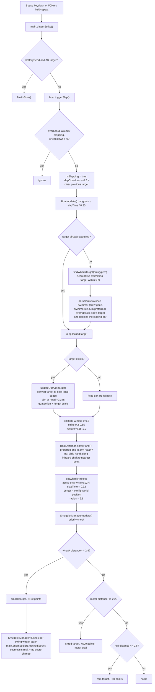

# 08 — Oar auto-aim / head smack

Sources: `src/main.js` (input and AK fallback), `src/entities/Boat.js` (swing, aim, hitbox), `src/entities/BoatCrew.js` (gaze target), `src/entities/SmugglerManager.js` (hit resolution).

## Logic

- The swing locks the first valid target at the start of the strike, so the blade cannot chase a different smuggler after the intended one is already hit.
- `findWhackTarget` only considers live, visible smugglers in the `swimming` state within 6 m.
- `updateOarAim` converts the target to boat-local coordinates, aims at the head (`group.y + 0.3`) from the oar pivot (`y + 1.5`), and scales the oar length to the distance.
- The hitbox follows the visible blade tip (`oarTip`) when a target is locked; without a target it uses the fixed swing arc.
- Hit priority is oar whack (+100), then motor shred (+500), then hull ram (+50).
- Successful whacks are accumulated per swing and flushed together by `SmugglerManager`; `main.js` registers the cosmetic streak with the batch count (see [16-kill-streak.md](16-kill-streak.md)). Points per kill are unchanged.
- While the oarsman is overboard, `getWhackHitbox()` returns `null`, so the detached oar cannot hit anything.
- Cross-cutting lifecycle wiring in `main.js` (screen wake lock #20, offline service worker #22) is orthogonal to the strike/aim flow above and does not change it.

## Decisions

- **Decision:** When the preferred grip point is beyond arm reach (> 92% of `MAX_REACH`), the hand slides along the inboard shaft (y -0.68..0.6) to the point nearest the shoulder.
  **Why:** Swings aim the oar at distant targets, so the fixed grip left the arm clamped at max reach and the hand detached from the oar.
  **Alternatives:** Moving the oarsman's body/shoulders with the swing (more animation work); shortening the swing arc (changes gameplay).

- Crew anchoring: `officerGroup` and `playerGroup` (oarsman, oar pivots) are children of `Boat.hull`, so the banking roll carries both soldiers with their benches. Man-overboard detaches `playerGroup` to the scene; recovery re-parents it to the hull.
- **Decision:** The swimmer the oarsman is looking at decides which oar swings. **Why:** requested; the left oar sometimes swung while the crew's heads were turned to an enemy on the right (nearest-per-side logic ignored the gaze). **How:** `BoatCrew.updateGaze` makes the oarsman prefer swimmers within 6 m (`OAR_TARGET_RANGE`) and exposes `strikeTarget`; `Boat.findWhackTargets` assigns it to its side and `closestSide` follows it. The other oar still joins only when its own enemy is within 4.5 m. **Alternatives:** keep nearest-per-side.
- **Decision:** No on-water hit cue ring (a yellow ring under the watched swimmer was tried and removed). **Why:** requested; the crew's head turn is the cue.
