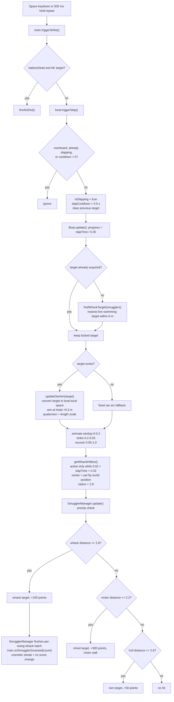

# 08 — Oar auto-aim / head smack

Sources: `src/main.js` (input and AK fallback), `src/entities/Boat.js` (swing, aim, hitbox), `src/entities/SmugglerManager.js` (hit resolution).

## Logic

- The swing locks the first valid target at the start of the strike, so the blade cannot chase a different smuggler after the intended one is already hit.
- `findWhackTarget` only considers live, visible smugglers in the `swimming` state within 6 m.
- `updateOarAim` converts the target to boat-local coordinates, aims at the head (`group.y + 0.3`) from the oar pivot (`y + 1.5`), and scales the oar length to the distance.
- The hitbox follows the visible blade tip (`oarTip`) when a target is locked; without a target it uses the fixed swing arc.
- Hit priority is oar whack (+100), then motor shred (+500), then hull ram (+50).
- Successful whacks are accumulated per swing and flushed together by `SmugglerManager`; `main.js` registers the cosmetic streak with the batch count (see [16-kill-streak.md](16-kill-streak.md)). Points per kill are unchanged.
- While the oarsman is overboard, `getWhackHitbox()` returns `null`, so the detached oar cannot hit anything.
- Cross-cutting lifecycle wiring in `main.js` (screen wake lock #20, offline service worker #22) is orthogonal to the strike/aim flow above and does not change it.
