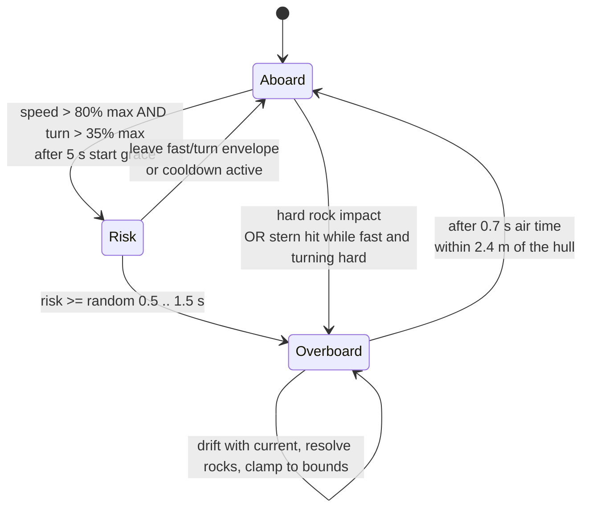
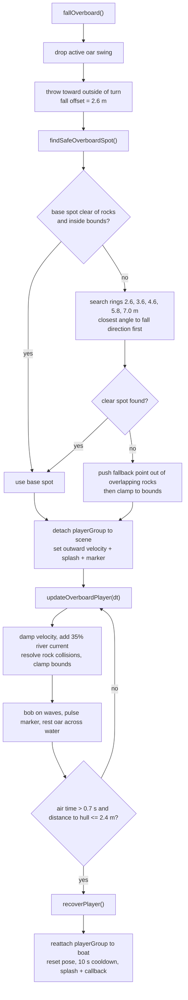

# 09 — Man overboard / oarsman pickup

Sources: `src/entities/Boat.js` (risk, fall, drift, recovery), `src/main.js` (alerts and partner lines).

## Logic

- **Risk path:** while off cooldown, being above 80% of max speed *and* above 35% of max turn rate builds `manOverboardRisk`. The fall threshold is randomized between 0.5 s and 1.5 s. Leaving the fast-turn envelope drains the risk at 1.5x.
- **Impact path:** a hard rock impact (normal speed <= -55% of max speed), or a stern-on rock hit while fast and turning hard, always throws him.
- **Landing:** the fall points to the outside of the turn, then searches outward rings for open water so he never lands inside a rock cluster the hull cannot reach.
- **Drift:** the detached oarsman keeps his outward velocity, is damped, carried by 35% of the river current, pushed out of rocks, clamped to the play bounds, and bobs on the wave height.
- **Recovery:** after a 0.7 s minimum air time, driving the hull within 2.4 m picks him up. The boat then has a 10 s cooldown before another fall can start.
- Losing him also costs 8% of boat velocity and cancels any active oar strike. `main.js` receives the `onManOverboard` / `onManRecovered` callbacks from the `Boat` constructor and shows the danger/men-recovered alerts, partner line, screen shake, splash, and alert sound.
