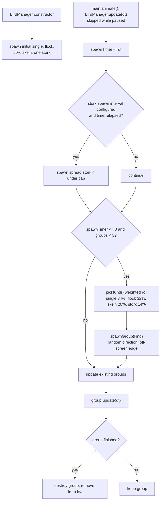
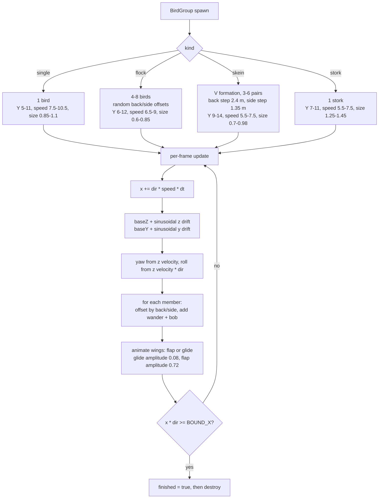

# 10 — Flying birds / flocks / migration skeins

Sources: `src/entities/Birds.js` (`BirdManager`, `BirdGroup`, `Bird`), updated from `src/main.js`.

## Logic

- `BirdManager` keeps at most 5 groups and respawns every 4-11 seconds.
- `pickKind()` uses a weighted roll: single bird 34%, flock 32%, migration skein 20%, stork 14% (configurable).
- Initial groups spawn anywhere across the river; later groups enter from the off-screen edge in a random direction.
- Each kind has its own altitude, speed, and size range. Flocks use random offsets; skeins use a strict V formation with much less jitter.
- Members share the group's flap phase, but each has its own bob, wander, yaw, and roll jitter. A slow glide oscillator briefly reduces flap amplitude.
- A group is removed once its lead bird crosses `BOUND_X = sx(118)`.
- Birds are ambient only; there is no collision yet (see feature #1).
- `main.animate()` advances `BirdManager` only when the game is not paused, so groups and spawn timers freeze with the patrol.
