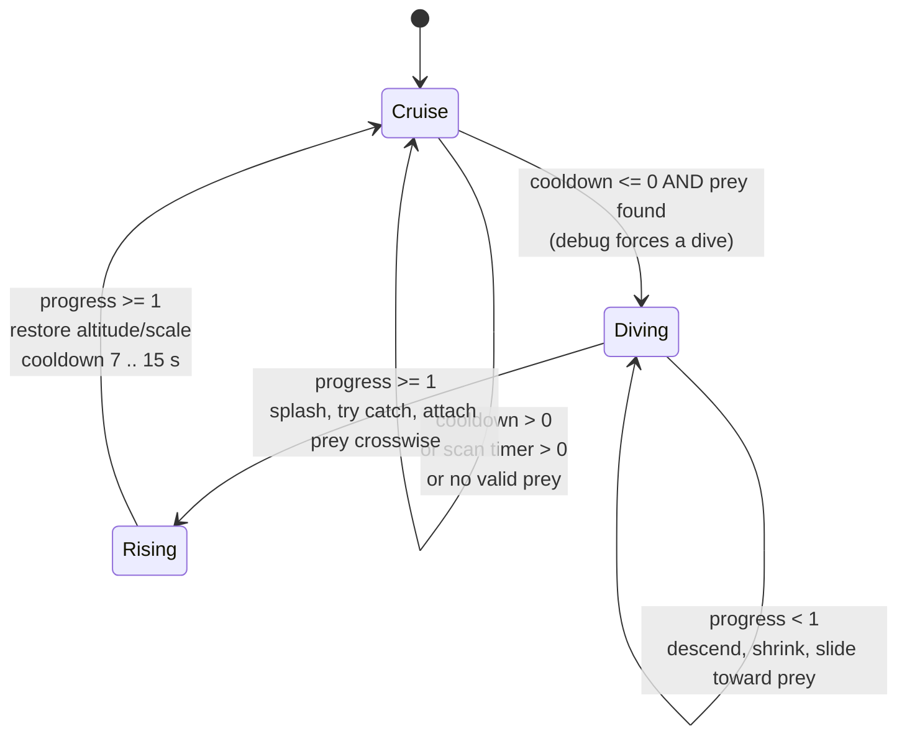
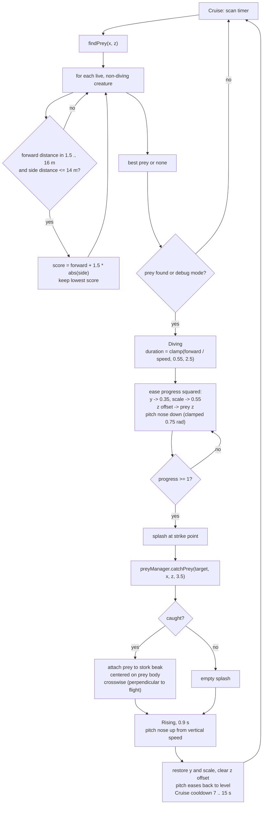

# 11 — Storks / hunting dives

Sources: `src/entities/Birds.js` (`BirdGroup` stork state machine), `src/entities/WildlifeManager.js` (`catchPrey`).

## Logic

- Storks always fly alone and use a higher, slower flight profile than other birds.
- `findPrey` only targets live creatures ahead of the stork (1.5-16 m forward, within 14 m sideways) and prefers the lowest `forward + 1.5 * |side|` score.
- On commit, dive duration comes from the forward distance divided by flight speed, clamped to 0.55-2.5 s. The stork shrinks to 55% scale and slides toward the prey's Z position.
- At the bottom it emits a splash and calls `catchPrey` with a 3.5 m radius. `catchPrey` rejects dead, finished, or diving prey and removes the caught creature from the wildlife list.
- A caught frog/snake is re-parented to the stork's beak at the prey's body center, oriented crosswise (perpendicular to the bird's flight direction), then carried through the climb.
- `Rising` takes 0.9 s, restores scale and altitude, then sets a 7-15 s cruise cooldown.
- Storks are advanced by the shared `BirdManager.update(dt)` loop that `main.animate()` runs unless the game is paused, so their dive state freezes with the patrol like the other birds.
- Stork pitch follows its vertical speed: the nose angles down toward the water during a dive, up away from it during the climb, and eases back to level in cruise. Pitch is clamped to 0.75 rad (~43°) and smoothed so the transitions do not snap.
- Debug/tuning: `?storkDive=1` / `VITE_STORK_ALWAYS_DIVE=1` forces dives, `?storkSpawn=` / `VITE_STORK_SPAWN_INTERVAL` adds dedicated spawns, `?storkWeight=` / `VITE_STORK_SPAWN_WEIGHT` changes the random bird mix.
- Cross-cutting lifecycle wiring in `main.js` (screen wake lock #20, offline service worker #22) is orthogonal to the stork state machine above and leaves it unchanged.
