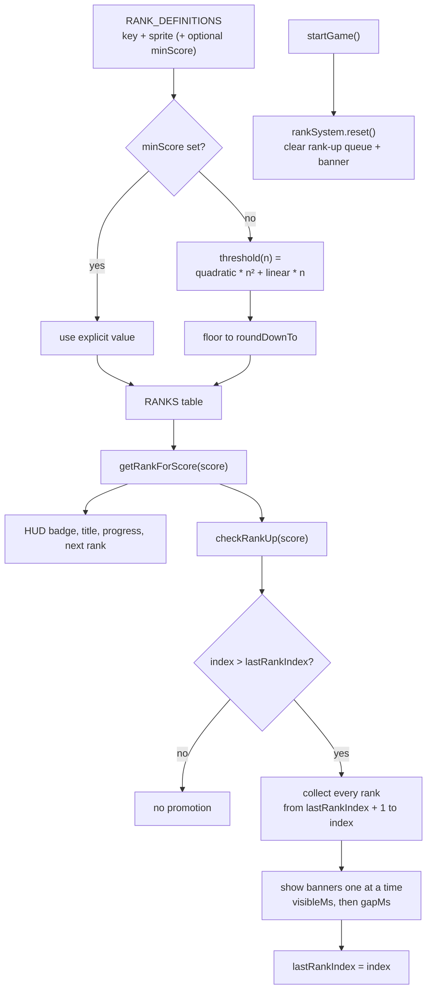
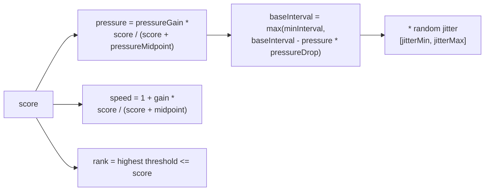

# 12 — Ranking system rework

Sources: `src/config/ranking.ts` (rank definitions, curve, banner timing), `src/config/difficulty.ts` (speed + spawn tuning), `src/systems/RankSystem.ts` (thresholds + promotion detection), `src/main.js` (HUD + banner queue), `src/entities/SmugglerManager.js` (difficulty scaling).

## Logic

- Tunables are split by concern: `src/config/ranking.ts` holds `RANK_DEFINITIONS` (order, i18n key, sprite, optional `minScore` pin), `RANK_CURVE` (quadratic, linear, `roundDownTo`), and `PROMOTION_TUNING`; `src/config/difficulty.ts` holds speed and spawn tuning.
- Defaults: `70n² + 500n` rounded down to 50 gives Junior Lieutenant at 10,150 and General at 31,650. The smallest gap is 550, above the 500-point propeller kill, so one kill cannot skip a rank.
- `checkRankUp` returns every crossed rank in order. `main.js` queues them and chains banners (`visibleMs`, then `gapMs`), clearing the queue when a run starts. This preserves intermediate promotions that the old single-return version silently dropped.
- Difficulty uses asymptotic curves instead of hard caps: `1 + gain * score / (score + midpoint)` for speed and a pressure ratio for spawn timing, so high scores keep ramping. Waves within `warmupWaves` use the calmer `warmupMin..warmupMax` range.
- Ranks remain per-run; `startGame()` resets `rankSystem`, clears the pending promotion queue, hides the active banner, and resets the run score.
