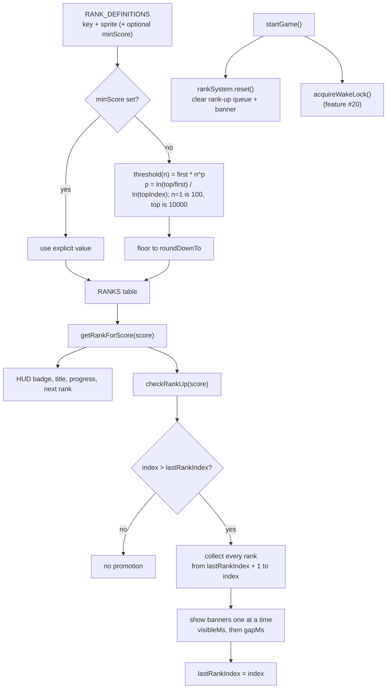
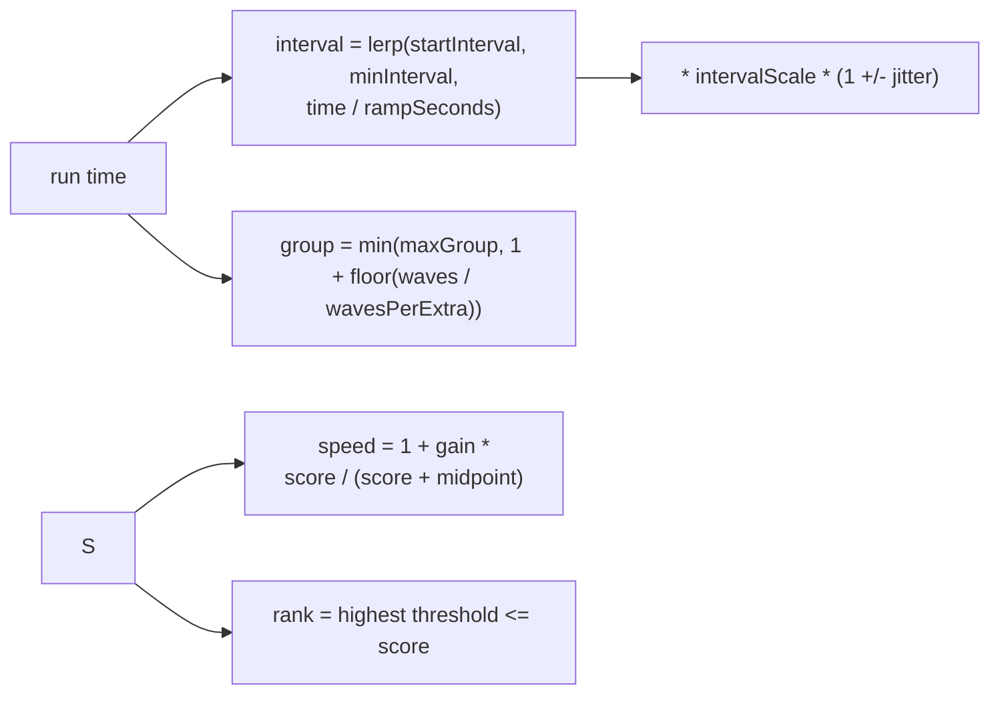

# 12 — Ranking system rework

Sources: `src/config/ranking.ts` (rank definitions, curve, banner timing), `src/config/difficulty.ts` (speed + spawn tuning), `src/systems/RankSystem.ts` (thresholds + promotion detection), `src/main.js` (HUD + banner queue), `src/entities/SmugglerManager.js` (difficulty scaling).

## Logic

- Tunables are split by concern: `src/config/ranking.ts` holds `RANK_DEFINITIONS` (order, i18n key, sprite, optional `minScore` pin), `RANK_CURVE` (first/top rank score, `roundDownTo`), and `PROMOTION_TUNING`; `src/config/difficulty.ts` holds speed and spawn tuning.
- Defaults: `70n² + 500n` rounded down to 50 gives Junior Lieutenant at 10,150 and General at 31,650. The smallest gap is 550, above the 500-point propeller kill, so one kill cannot skip a rank.
- `checkRankUp` returns every crossed rank in order. `main.js` queues them and chains banners (`visibleMs`, then `gapMs`), clearing the queue when a run starts. This preserves intermediate promotions that the old single-return version silently dropped.
- Difficulty uses asymptotic curves instead of hard caps: `1 + gain * score / (score + midpoint)` for speed and spawn timing is linear in run time (see Decisions).
- Ranks remain per-run; `startGame()` resets `rankSystem`, clears the pending promotion queue, hides the active banner, and resets the run score.
- `startGame()` also acquires the screen wake lock (released on pause and game over), and `main.js` registers the offline service worker at boot; both are orthogonal to ranking ([20-wake-lock.md](20-wake-lock.md), [22-offline-pwa.md](22-offline-pwa.md)).

## Decisions

- **Spawn interval scale 2.5 → 1.7 (`VITE_SMUGGLER_SPAWN_INTERVAL_SCALE`).** Why: after slowing spawns, runs felt empty, especially during the battery-out view. Alternative: leave 2.5 and rely on `?spawn=` for testing. Revisit when: spawn pacing is playtested with AK back on.

- **Decision:** Spawn pacing is linear in run time with deterministic group sizes, replacing score-based pressure, random group sizes (1-4), ±30% jitter and random warmup. **Why:** runs were unpredictable (a pile at once in one run, 2 smugglers in another) and score feedback made fast players swarmed. **Alternatives:** keep score pressure with smaller jitter (still reactive). Tune via `VITE_SPAWN_*`; set `VITE_SPAWN_JITTER=0` for a metronome.
- **Spawn interval scale 1.7 → 2.1 (`VITE_SMUGGLER_SPAWN_INTERVAL_SCALE`).** Why: requested; spawns felt slightly too frequent now that swimmers appear 100-250 m out and arrows track them. Alternative: lower the group size instead.
- **Spawns cut significantly: interval scale 2.1 → 3.2, max group 3 → 2, new alive cap `VITE_SPAWN_MAX_ALIVE` (5).** Why: requested; while cruising on, swimmers kept spawning in droves behind the boat and dormant ones piled up. Waves are trimmed or skipped at the cap. Alternative: only lower the interval scale.
- **Decision:** Rank thresholds are a power curve from the first rank (`VITE_RANK_FIRST_SCORE` 100, so the first kill promotes) to the top rank (`VITE_RANK_TOP_SCORE` 10000), `first * n^p` with `p = ln(top/first) / ln(topIndex)`, rounded down to `VITE_RANK_ROUND_TO` (50). **Why:** requested; the earlier x5 quadratic nerf put rank 2 at 6400 and the top near 150k, which felt bonkers. A fixed top score with gradual steps (100, 300, 550, 900, 1250 ... 9100, 10000) keeps every promotion reachable. **Alternatives:** x5 scale (too steep), shifted original quadratic (top ~28k), pinning only rank 1 (lumpy jump).
