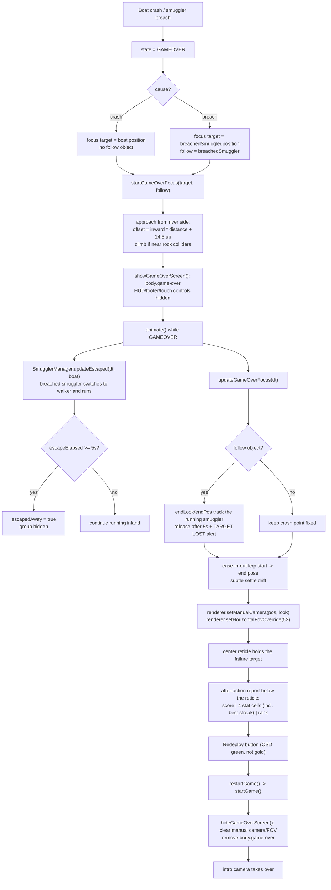

# 13 — Game over target-lock screen

Source: `src/main.js`, `src/entities/Smuggler.js`, `src/entities/SmugglerManager.js`, `index.html`, `src/style.css`.

## Logic

- Game over is a full-screen OSD layer, not a modal card: no backdrop blur, no boxed panel.
- The drone eases from the live gameplay pose to a close pose over the crash or breach point, and narrows the horizontal FOV from the gameplay value to 52°.
- The target pose is built from the river-side direction (toward the river centre), not from the old camera position. Crash points sit inside rock/reed belts, so this keeps the drone over open water. It then climbs and backs farther into open water while `world.isNearRock` reports intersection, which removes the severe near-plane clipping through bank rocks.
- `manualCamera` owns the camera while `state === 'GAMEOVER'`, so the normal follow rig cannot pull focus away from the action.
- After a breach, `SmugglerManager.updateEscaped` keeps updating only the smuggler who crossed. `Smuggler` switches from the swimmer mesh to the walker mesh at the south bank and runs inland; the camera follows it so the action stays centered.
- The escape is capped at 5 seconds (`ESCAPE_RUN_SECONDS`). The runner then leaves the world and is hidden, the camera releases its follow target and holds the last pose, and the OSD shows `TARGET LOST`.
- After the dolly-in completes, a slow settle drift keeps the shot alive without moving the target off center.
- The reticle is fixed at screen center, which is where the focus point projects. The failure target is left unobstructed; all interface chrome lives in an after-action report strip anchored below it.
- Breach shots use a slightly lower/farther offset and the focus end pose follows the running smuggler, so they stay framed while they escape.
- The report uses a fixed three-column grid: final score, four equal stat cells (smacked, frogs, vipers, best streak) with short labels, then rank. Equal cells and nowrap labels keep values aligned.
- The redeploy button uses the same clipped, green, mono/display styling as the drone OSD instead of the gold `action-btn` treatment.
- Restart clears the focus, manual camera and FOV override before the intro shot starts again.
