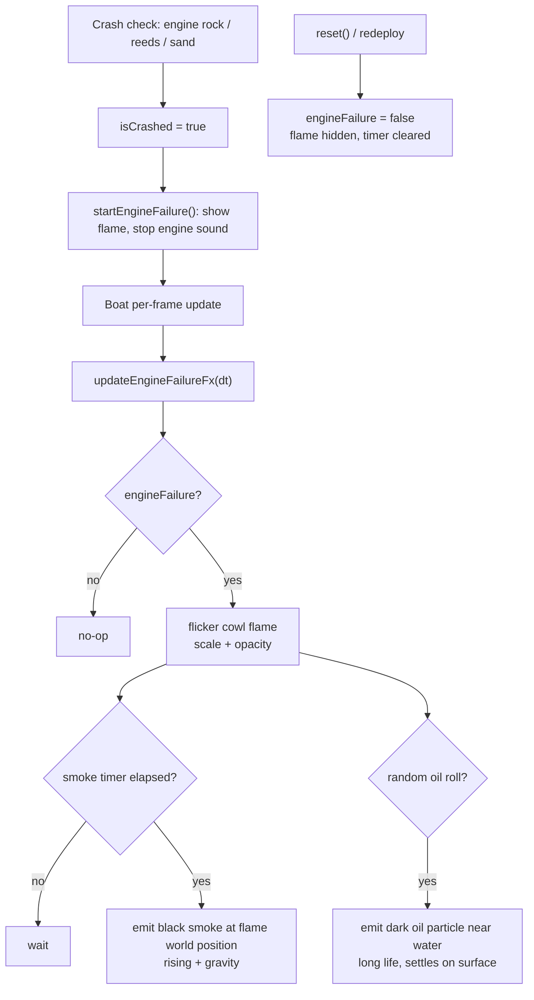

# 14 — Engine failure smoke, flame and oil leak

Source: `src/entities/Boat.js`, particles from `src/world/River.js`.

## Logic

- `startEngineFailure` runs in the fatal engine-contact branch (`engineRock`, `engineStuckNorth`, `engineStuckSouth`, including bank-ram engine hits).
- The flame is an additive orange cone with a smaller yellow core parented to `motorPivot`, so it follows the boat and steering tiller. Scale/opacity flicker with time and a random core opacity.
- Smoke is emitted from the flame's world position through the shared instanced particle pool: dark grey, rising, short-lived. The pool applies gravity and clamps particles to the water surface.
- A smaller random chance emits a long-lived very dark particle just above the water behind the motor, reading as petrol/oil on the surface.
- Effects continue during `GAMEOVER` because `Boat.update` still runs with idle input, so the failure stays visible under the target-lock camera.
- `reset` hides the flame, clears the timer and re-enables normal engine sound for the next run.
