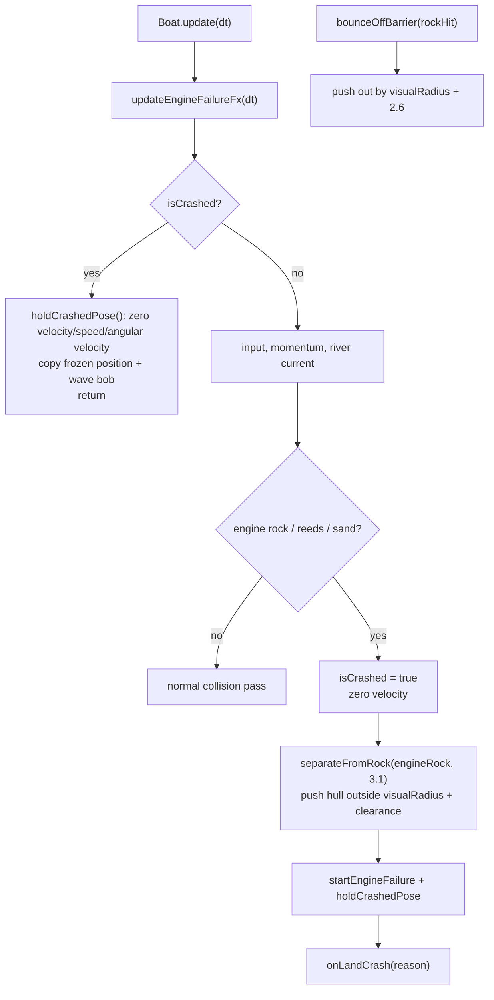

# 15 — Rock-safe crash freeze and separation

Source: `src/entities/Boat.js`.

## Logic

- Rock collision separation now uses `visualRadius` (the visible dodecahedron scale) instead of the smaller physics radius, with enough clearance for the hull/motor, so the mesh does not visibly enter the stone.
- Fatal engine rock hits run `separateFromRock` before the crash callback, placing the boat fully outside the rock.
- Once `isCrashed` is true, `update` short-circuits to `holdCrashedPose`. No input, momentum, steering or river-current advection is applied after the failure frame.
- `holdCrashedPose` keeps the frozen hull at the crash point with only the existing wave bob, so the game-over camera can circle above without the boat sliding through rocks or reeds.
- `reset()` clears `isCrashed` for the next run.
