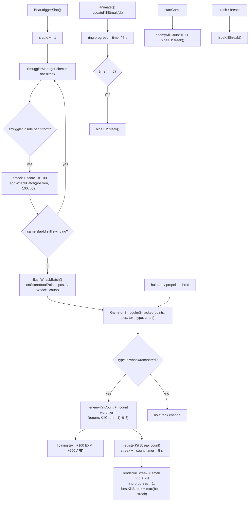

# 16 — Oar kill streak

Source: `src/main.js` (streak state, ring, batching UI), `src/entities/Boat.js` (`slapId`), `src/entities/SmugglerManager.js` (per-swing hit batching), `src/systems/I18n.ts` (hit words), `index.html` / `src/style.css` (circular banner).

## Logic

- Whacks, hull rams (`ram`), propeller shreds (`shred`) and AK shots (`ak`) all feed the streak timer/multiplier and advance the word counter. Only oar whacks are batched per swing.
- The banner is a compact row anchored to the oar blade via world-to-screen projection every frame: a small circular timer ring sits beside the multiplier (`×N`). This keeps it clear of boat/collision text bubbles. It is not a large badge or pill.
- `--streak-progress` starts at 1 on each new kill and shrinks to 0 over 5 seconds, drawing the conic-gradient ring beside the multiplier.
- The floating popup word uses a run-wide enemy counter, not the streak counter: 1 БУМ, 2 ЛЯП, 3 ГЕП, 4 БУМ, 5 ЛЯП, 6 ГЕП. The counter survives streak gaps and resets only when a new run starts.
- Colour tier still escalates with the streak (1 yellow, 2 amber, 3+ red) while the word keeps cycling.
- `bestKillStreak` records the highest live streak in the run and is shown as `×N` in the game-over after-action report (`final-streak`). It resets with the run.
- Hits from one space swing are batched by `boat.slapId`. When the swing ends, the manager flushes one combined callback: 2 kills become a single `+200 ЛЯП` popup and `registerKillStreak(2)`.
- The streak is cosmetic: score and hit values in `SmugglerManager` are unchanged per kill; only the presentation is combined.
- Starting a run, crashing, or breaching hides the banner immediately.
- Debug tuning: `VITE_KILL_STREAK_SECONDS=<seconds>` or `?streak=<seconds>` overrides the 5-second window (clamped to 0.1–120 s).
