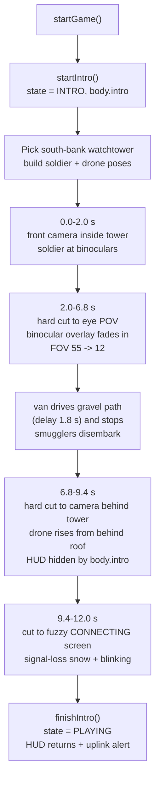

# 17 — Watchtower cinematic intro

Sources: `src/main.js` (`startIntro`, `updateIntro`, `getIntroCameraPose`, `getIntroDronePosition`, `finishIntro`), `src/entities/WatchtowerSoldier.js`, `src/entities/Drone.js`, `src/systems/ConnectScreen.js`, `src/world/River.js` (`createWatchtower`, gravel-path intro drop), `index.html` / `src/style.css` (binocular viewport and connecting feed).

## Logic

- The cinematic runs before gameplay while `state === 'INTRO'`; the OSD/HUD is hidden by `body.intro .drone-osd`.
- A south-bank watchtower is selected (`x > 0`) and its cabin is an open-front shell so the soldier and camera can sit inside. The platform is raised well above the tall north-bank reeds.
- Scene 0 frames the guard through the tower window, so both the tower front and the guard holding the binoculars are visible.
- Scene 1 hard-cuts to the soldier's eye position, narrows the FOV to 12°, and shows the existing minivan arrival through the binocular mask. The overlay uses the periscope/binocular artwork in `src/assets/binocular-overlay.png`, keyed to transparent lenses. The intro drop was moved near the reed line so the road corridor is visible from the tower.
- Scene 2 hard-cuts straight from the binocular feed to the single drone shot: the 3D drone rises from behind the tower roof with the same battlefield behind it. There is no camera pan and no separate chase shot.
- Scene 3 cuts to a fuzzy `CONNECTING` feed (`ConnectScreen`) styled like the signal-loss screen: grayscale snow, a blinking red connection bar, then a hard cut to the gameplay camera. `finishIntro()` restores the HUD and shows the uplink/patrol alert. The hidden actors are precompiled with `compileAsync()` during the start modal.
- Skipping the intro calls `finishIntro()` directly, which hides all cinematic objects and the binocular overlay.
