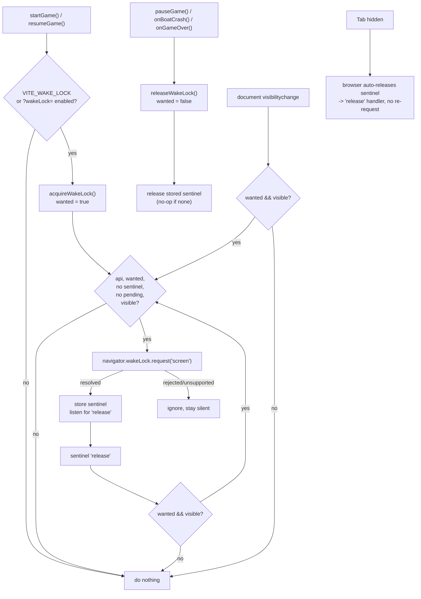

# 20 — Wake Lock (keep the screen on)

Source: `src/systems/WakeLock.ts`, called from `src/main.js`.

## Logic

- A single module-scoped `wanted` flag records player intent; the sentinel itself is owned by the browser and can be revoked at any time.
- `acquireWakeLock` is idempotent: repeated calls during a run do not stack requests (`sentinel`/`pending` guards).
- The browser requires a secure context and a visible document; unsupported browsers or rejected requests fail silently, so the game is unaffected.
- The screen lock is held across the cinematic intro and gameplay, released on pause and on both game-over paths, and reacquired on resume.
- When the tab is hidden the browser releases the sentinel automatically; on `visibilitychange` back to visible the module re-requests because `wanted` is still true.
- Enabled by default. Toggle for testing with `VITE_WAKE_LOCK=0` (build/env) or `?wakeLock=0` (per-load, overrides the env). Truthy values: `1/true/on/yes`; falsy: `0/false/off/no`. When disabled, `acquireWakeLock()` is a no-op.
