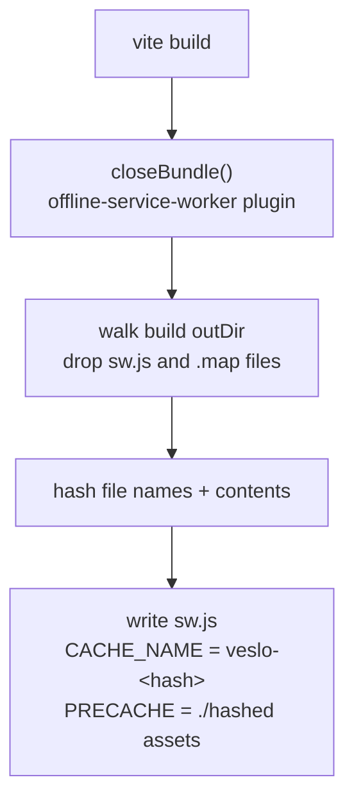
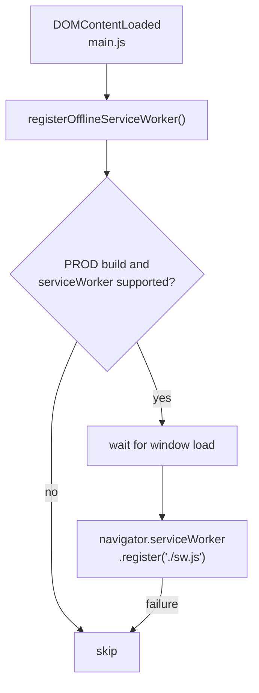
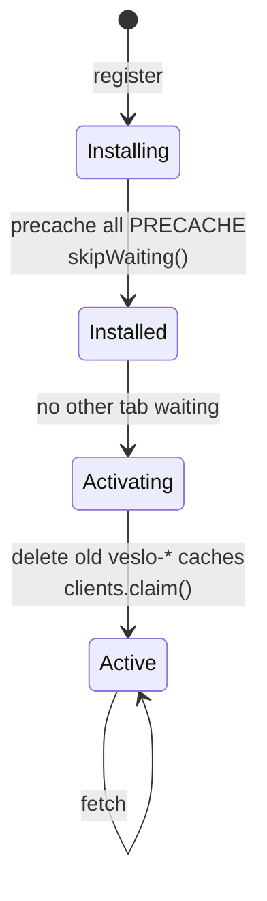
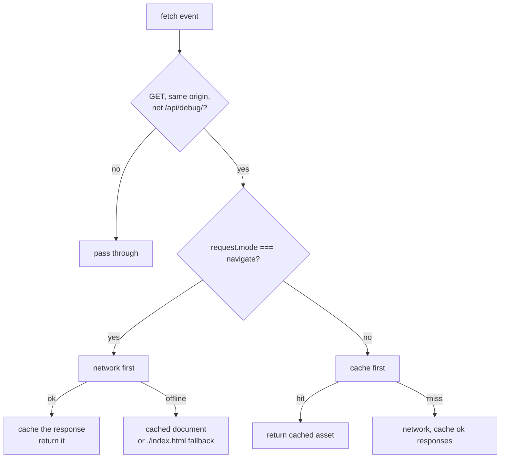

# 22 — Service worker / offline PWA

Sources: `vite.config.js` (`offline-service-worker` plugin), `src/systems/ServiceWorker.ts`, registered from `src/main.js`.

## Logic

- `sw.js` is generated only on `vite build`, so `npm run dev` is never affected by a stale worker.
- The precache list is every file in the build output (hashed JS/CSS, fonts, audio, ranks, icons, manifest, `index.html`). The cache name includes a hash of every file's name **and contents**, so any real change — even a content-only edit to `index.html` or an icon — produces a new worker, a new cache, and an old-cache purge.
- Registration uses `{ updateViaCache: 'none' }` and rechecks for a new worker on `visibilitychange` (visible), `focus`, and `online`, throttled by `VITE_SW_UPDATE_INTERVAL` seconds (default 300) or `?swUpdate=` seconds.
- Navigation uses network-first so a fresh deploy is picked up immediately, with the cached document as the offline fallback. Hashed assets use cache-first because their URLs are immutable.
- Registration is production-only and silent on failure. There is deliberately no runtime disable flag: offline caching is always on for players, and a disable switch cannot remove a worker that is already installed. Unregister via DevTools when debugging.
- Test offline with `npm run build && npm run preview`, load once while online, then switch the browser to offline and reload. A normal `npm run dev` session has no worker.
