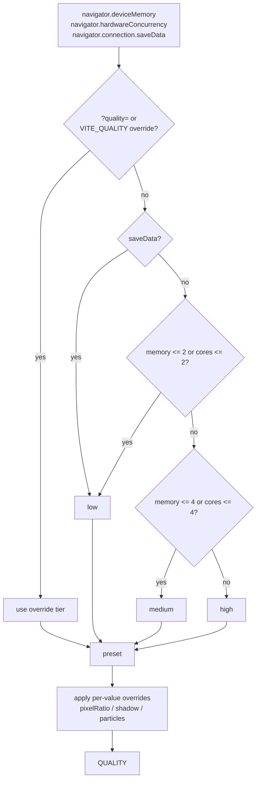
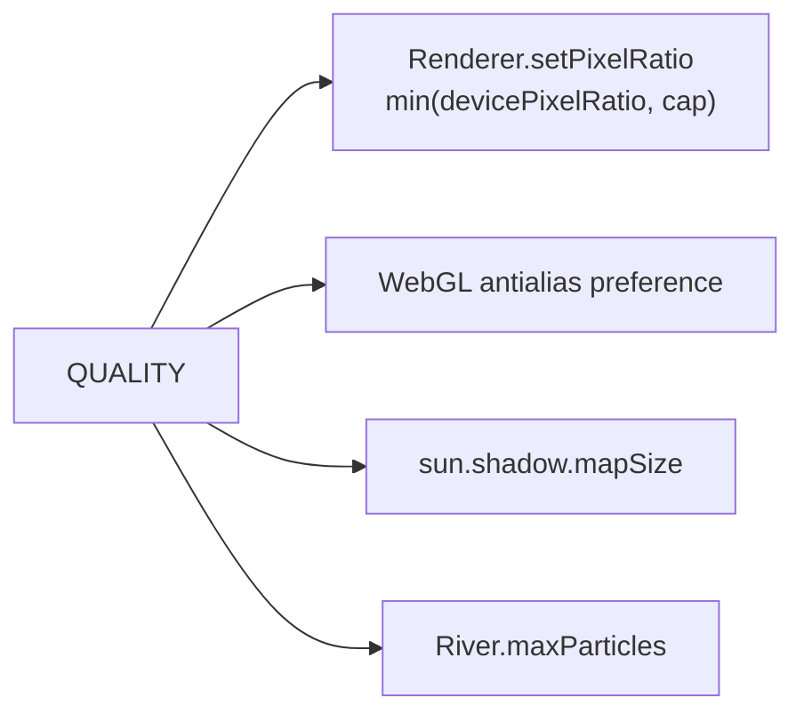

# 24 — Adaptive quality from device hints

Sources: `src/config/quality.ts`, consumed by `src/core/Renderer.ts` and `src/world/River.js`.

## Logic

- Tier is chosen once at module load from coarse device hints. `saveData` forces `low`; low memory or ≤2 cores is `low`; ≤4 of either is `medium`; otherwise `high`.
- Browsers that expose no hints (or no `navigator`) fall through to `high`, preserving the previous desktop behaviour.
- Presets:
  - `low`: pixel ratio cap 1, shadow map 512, 90 particles, no MSAA.
  - `medium`: pixel ratio cap 1.25, shadow map 1024, 160 particles, MSAA.
  - `high`: pixel ratio cap 1.5, shadow map 1024, 220 particles, MSAA.
- `Renderer` applies the pixel-ratio cap in `setPixelRatio`, uses the antialias preference for its renderer attempts, and sizes the sun shadow map from the tier. `River` uses the particle budget for its instanced particle pool.
- Tunables: `VITE_QUALITY` / `?quality=` (`auto`/`low`/`medium`/`high`), plus per-value `VITE_PIXEL_RATIO_CAP` / `?pixelRatio=`, `VITE_SHADOW_MAP_SIZE` / `?shadow=`, `VITE_PARTICLE_BUDGET` / `?particles=`. Values are clamped to safe ranges (pixel ratio 0.5–3, shadow 256–4096, particles 30–600).
- The dev stats overlay prints the chosen tier, source and applied values.
