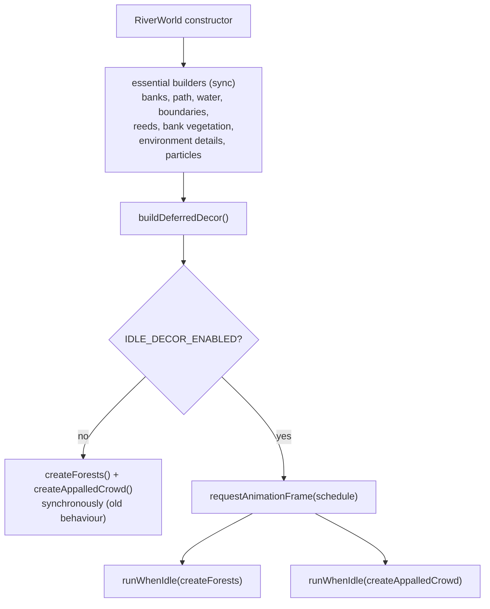
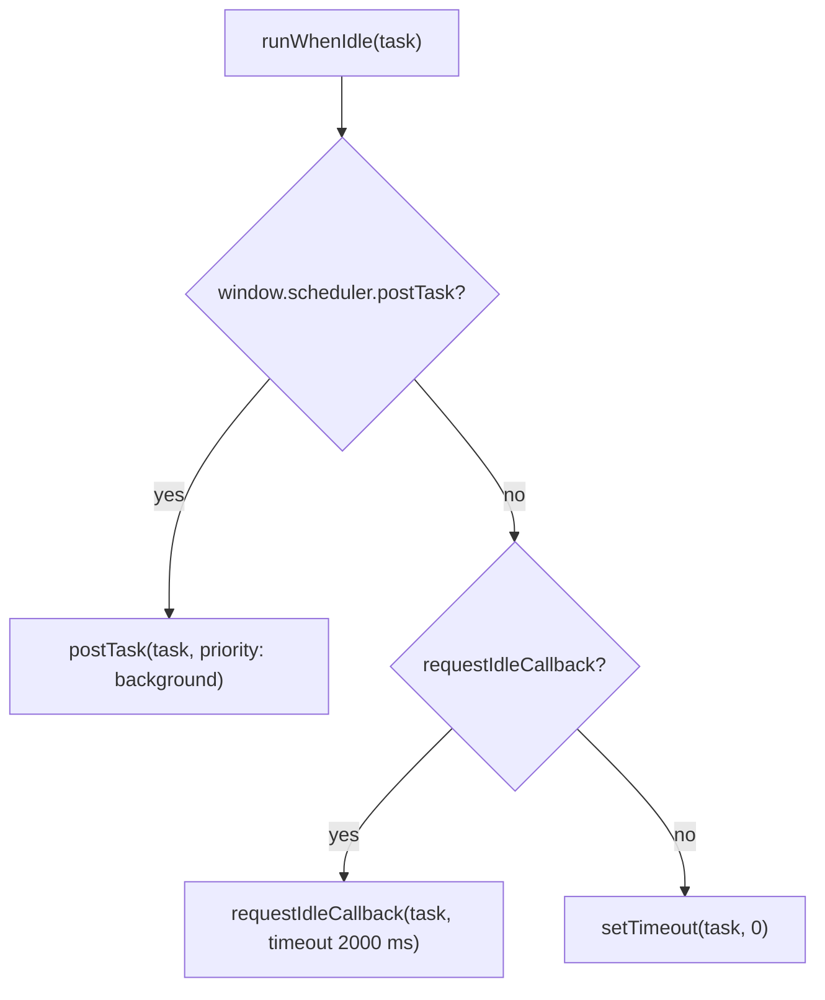

# 25 — Idle-time scheduling

Sources: `src/systems/IdleScheduler.ts`, used from `src/world/River.js`.

## Logic

- Boot still builds everything gameplay depends on synchronously: banks, gravel path, water, boundary rocks/colliders, reeds, bank vegetation, watchtowers/environment details, and the particle system used by effects.
- Only `createForests()` and `createAppalledCrowd()` are deferred. They are purely visual, no collider or spawn code reads them, and nothing in the run depends on them being present.
- Scheduling waits for one `requestAnimationFrame` so the first frame can paint, then queues each builder separately to avoid one long task.
- The runner prefers `scheduler.postTask({ priority: 'background' })`, falls back to `requestIdleCallback` with a 2 s safety timeout, then `setTimeout(0)`.
- Deferred work finishing during the 10+ second cinematic intro means no visible pop-in in normal play; a fast skip still leaves the world playable.
- Tunable: `VITE_IDLE_DECOR` defaults to `true`; `?idleDecor=0` builds the decoration synchronously for A/B comparisons (truthy: `1/true/on/yes`, falsy: `0/false/off/no`).
