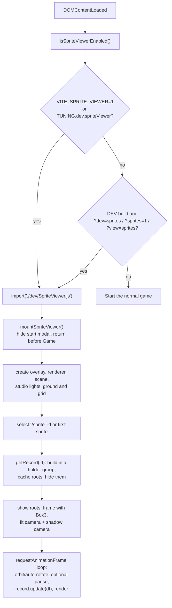
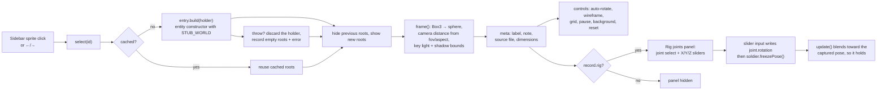

# 34 — Dev sprite viewer

Sources: `src/dev/SpriteViewer.js` (`SpriteViewer`), `src/dev/sprites.js` (`SPRITE_GROUPS`, build adapters), `src/entities/Soldier.js` (joint rig + `SOLDIER_JOINT_LABELS`), `src/entities/Birds.js` (`createPreviewBird`), `src/main.js` (enable check / mount branch), `src/config/tuning.ts` (`TUNING.dev.spriteViewer`).

Per-sprite review checklist and model inventory: [docs/sprite-review.md](../sprite-review.md).

## Logic

- The viewer is never part of the normal game boot. `isSpriteViewerEnabled()` checks the build-time `VITE_SPRITE_VIEWER` flag, then `TUNING.dev.spriteViewer`, then the dev-only query flags. A production build does not respond to `?dev=sprites` unless one of the build-time flags is set.
- `main.js` returns early after mounting the viewer, so the river, audio, service worker, wake lock, intro and HUD never start.
- `SPRITE_GROUPS` is the catalog. Each entry names a label, note, source file and a `build(stage)` adapter that constructs the existing entity class with `stage` acting as its scene and returns the root `Object3D`s plus an optional `update(dt, time)`.
- `STUB_WORLD` supplies only the fields entity constructors read (`gravelPath`, `northBankY`, `rockColliders`, effect no-ops). No `RiverWorld` is created.
- Records are built lazily and cached. Switching sprites toggles root visibility instead of rebuilding, which avoids leaking GPU resources from repeated construction and keeps shared module-level geometries/materials valid.
- Each build runs against a throwaway holder `Group` (not `this.stage`). Entity constructors add themselves to the scene they are handed, so if a builder throws halfway (e.g. a missing import in a composition adapter) the holder is discarded and nothing is orphaned on the stage. On success the holder's children are adopted as roots alongside the declared ones, so a sprite that self-adds extra top-level objects is still fully toggleable.
- Framing uses `Box3` → `Sphere`, then fits the camera to both the vertical and horizontal field of view; this makes small frogs and the long minivan appear at comparable screen sizes. The key light, shadow target and shadow-camera bounds follow the active bounding sphere.
- Deep links: `?dev=sprites&sprite=<id>` selects a catalog entry on mount; `syncUrl()` keeps `dev=sprites` and `sprite=<id>` in the address bar while browsing. Unknown IDs fall back to the first sprite.
- Controls: drag orbits, wheel/pinch zooms, right-drag or shift-drag pans, double-click resets. Keyboard: ←/→ cycle sprites, `W` wireframe, `G` grid, `Space` pause animations, `O` auto-rotate, `R` reset view. `A`/`D` steer composite sprites that read input (`boat-officer`); other sprites ignore them.
- Wireframe traverses every cached record so switching sprites keeps the same render mode; shared materials are restored when wireframe is turned off.
- Rigged sprites return `record.rig` (currently the shared `Soldier` from `soldier-idle`). `setRig()` fills the **Rig joints** panel from `rig.joints` and `rig.jointLabel()`, and hides the panel for every other sprite. A slider writes the joint's Euler angle and calls `soldier.freezePose()`, which snapshots the current rotations into `targets` so the idle blend in `update()` holds the pose instead of snapping back. **Reset pose** calls `setPose('idle', true)`.
- Parts are catalogued separately from compositions: `boat`, `oar` and `soldier-idle` are raw models; `boat-officer` is a preset that composes them so the join can be reviewed without baking crew into the boat.
