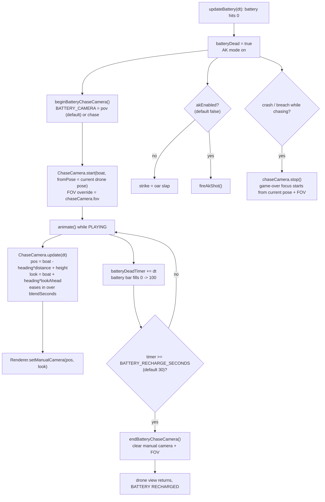

# 35 — Battery-out chase camera

Source: `src/core/ChaseCamera.ts`, `src/core/MountCamera.ts`, `src/entities/BoatOfficer.js`, `src/main.js`, `src/config/tuning.ts`, `src/style.css`.

`ChaseCamera` is renderer-agnostic: it takes any `{ position, angle? }` target and exposes `position`/`look`; the caller applies the pose. Reuse it for other entities or cinematic shots by calling `start(target, fromPose)` / `update(dt)` / `stop()`.

`pov` mode uses `MountCamera`: the eye sits on the engine operator's head joint (head/helmet hidden), faces along the boat, near plane drops to 0.1, and it rolls with the hull. `MountCamera` accepts any `{ anchor, orientation? }` object pair, so it works for any entity.

Knobs: `VITE_BATTERY_CAMERA` / `?batteryCam=pov|chase`, `VITE_POV_CAMERA_FOV` (80), `VITE_POV_CAMERA_BLEND_SECONDS` (0.8), `VITE_BATTERY_RECHARGE_SECONDS` / `?recharge=` (default 30), `VITE_CHASE_CAMERA_DISTANCE`, `_HEIGHT`, `_BLEND_SECONDS`, `_FOV`.

## Decisions

- **Battery-out shows the engine operator's first-person view, not a black screen.** Why: the black screen was dead time; seeing the scene keeps the player engaged. Alternative: third-person `ChaseCamera`, built first and kept as `?batteryCam=chase`.
- **Cameras are decoupled from the renderer and from the battery feature.** `ChaseCamera` and `MountCamera` only compute a pose; callers apply it via `Renderer.setManualCamera`. Why: reuse for other entities and cinematic shots.
- **Recharge is 30 s (was a hard-coded 5 s) and the bar fills during it.** Why: gives the new view time to matter and shows progress.
- **AK shooting is disabled while the battery is dead (`TUNING.akEnabled = false`).** The code, audio and reload stay; only `triggerStrike`/`fireAkShot` are gated in `main.js`. Why: battery-out is being reworked around camera views and AK interferes with testing. Re-enable with `VITE_AK_ENABLED=1` or `?ak=1`.
- **Local test overrides go in the gitignored `.env.local`** (e.g. `VITE_START_BATTERY=5`); defaults stay in `src/config/`. Why: `.env` was not ignored, and the game must never require an env file.

- **First-person view shows a large score readout at top-centre.** Why: the normal rank/score HUD is a small bottom panel that is easy to miss from the operator's eyes. Alternative: world-space label above the rower (not visible from inside the head).
