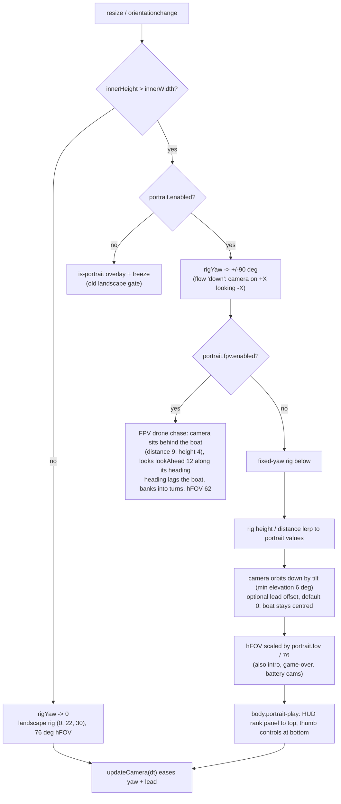

# 36 — Portrait (vertical) mobile play

Source: `src/core/Renderer.ts`, `src/main.js`, `src/config/tuning.ts`, `src/style.css`, `public/manifest.webmanifest`.

## Logic

- **FPV mode (default):** the portrait camera is a first-person-view drone chasing the boat: it hangs behind and above the hull, looks down the boat's heading, swings round behind turns with a lazy heading follow and banks into them. Touch steering is already relative to the boat's heading, so "left/right" feel natural. The fixed-yaw rig (below) is the fallback with `?fpv=0`.
- FPV knobs: `VITE_PORTRAIT_FPV` / `?fpv=0`, `VITE_PORTRAIT_FPV_DISTANCE` (9), `_HEIGHT` (4), `_LOOK_AHEAD` (12), `_FOV` (62), `_HEADING_STIFFNESS` (3), `_BANK` (1); defaults in `src/config/tuning.ts`. Tilt/lead/FOV below apply to the fixed-yaw rig only.

- The world is untouched: the river still runs along X. The camera rig swings 90° about the follow point so the long axis becomes the tall screen axis; the ~43 unit width fits the phone width.
- Steering stays tank-style (relative to the boat heading) and mouse aiming raycasts onto the water, so neither depends on the screen axes.
- The camera eases between rigs (`blendRate`), so rotating a phone swings the view rather than snapping.
- Touch layout is unchanged (throttle left, steer + strike right). The HUD is a vertical stack so nothing overlaps: telemetry bar, then one status row (battery left, rank panel centred, pause right, all on one centre line), then the viewfinder frame, all on the same side gutter, which now ends above the thumb controls (`--pt-*` variables in `src/style.css`). The telemetry bar drops the separators, patrol label and FPS to fit a phone width.
- Landscape keeps working exactly as before.
- Knobs (defaults in `src/config/tuning.ts`): `VITE_PORTRAIT_ENABLED` / `?portrait=0`, `VITE_PORTRAIT_FLOW` / `?flow=up|down`, `VITE_PORTRAIT_FOV` (17), `VITE_PORTRAIT_RIG_HEIGHT` (24), `VITE_PORTRAIT_RIG_DISTANCE` (30), `VITE_PORTRAIT_LEAD` (0, boat centred), `VITE_PORTRAIT_TILT` (25°: the camera orbits down toward the water at the same distance so the horizon rises into view while the boat stays centred; the elevation never drops below 6°).

## Decisions

- **Decision:** Rotate the camera rig instead of the world. **Why:** spawning, bounds, birds and wildlife all assume X-long; a camera yaw is a few lines and the 79×43 world is already close to a phone's shape. **Alternatives:** rotating world axes (large refactor), crop the landscape view (shows too much depth, tiny boat), chase camera only (loses the overview).
- **Decision:** Default flow is `down` (river runs toward the bottom). **Why:** it is what the landscape view looks like with the phone turned clockwise, so the north bank sits on the right. **Alternatives:** `up`, switchable with `flow` / `VITE_PORTRAIT_FLOW`.
- **Decision:** Narrow the horizontal FOV to 17° in portrait. **Why:** the landscape 76° gives a ~126 unit tall view and a small boat in a narrow screen. **Alternatives:** keep 76°.
- **Decision:** Touch devices are portrait-only: `screen.orientation.lock('portrait')`, manifest `orientation: portrait`, and a rotate-upright gate (`body.is-landscape-blocked`) that pauses play when held sideways. Desktop is unchanged. **Why:** requested; supersedes the earlier "landscape stays supported" decision. **Alternatives:** landscape-only on phones.
- **Decision:** Portrait defaults to an FPV-drone chase instead of the fixed-yaw rig. **Why:** a fixed world-aligned camera loses the boat's heading in turns and shows little of what is ahead; an FPV view shows the bow and the river ahead and pairs with heading-relative steering. **Alternatives:** the fixed-yaw rig (`?fpv=0`), the existing `ChaseCamera` (battery view only).
- **Decision:** The FPV chase camera also drives landscape/desktop (`TUNING.portrait.fpv.desktop = true`; off with `VITE_FPV_DESKTOP=0` / `?fpvDesktop=0`). **Why:** requested, one camera everywhere. **How:** `GameRenderer.fpvActive` is true in portrait or when `desktop` is set; landscape uses its own wider horizontal FOV `desktopFov` (90, `VITE_FPV_DESKTOP_FOV`) since the portrait 62 is tuned for narrow screens. Disabling it restores the old drone rig on desktop.
