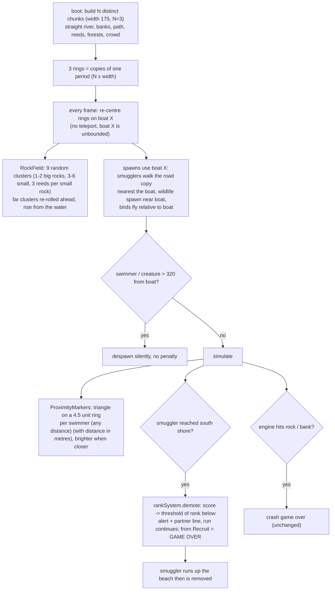

# 37 — Endless river, random rocks, breach demotion

Source: `src/world/River.js`, `src/world/Bounds.ts`, `src/world/RockField.js`, `src/config/world.ts`, `src/entities/SmugglerManager.js`, `src/entities/Smuggler.js`, `src/entities/Wildlife*.js`, `src/entities/Birds.js`, `src/systems/ProximityMarkers.js`, `src/systems/RankSystem.ts`, `src/core/Renderer.ts`, `src/main.js`.

## Logic

- **Endless world:** the river is a straight channel along X. `Bounds.ts` defines a chunk (`WORLD_CHUNK_WIDTH`, default 175) and `WORLD_CHUNKS` (3) chunks per period. Each chunk is generated separately (different randomness) and seams match because the river, banks and water are built to exactly the chunk width and vegetation/trees are folded into it. Three copies of the period are slid under the boat so the world never ends. Water waves are evaluated in world space so they stay continuous across seams.
- **Shadows:** the sun and its shadow frustum follow the boat (snapped to a 4 unit grid).
- **Rocks:** no more rock walls at the ends. `RockField` keeps `VITE_ROCK_COUNT` clusters alive (each 1-2 big rocks, 3-6 small rocks around them and 3 swaying reeds per small rock; every rock is a collider), re-rolling any that fall beyond `VITE_ROCK_RECYCLE_DISTANCE` ahead of the boat's direction of travel. Colliders are the same `world.rockColliders` the boat and smugglers already used.
- **Breach:** a smuggler reaching the south shore calls `rankSystem.demote(score, VITE_BREACH_RANKS_LOST)`; the score drops to the threshold of the lower rank. A breach at Recruit (deranking below the lowest rank) is game over (`eliminated`, score kept). Difficulty is score-driven so it eases too. High score uses the peak score of the run.
- **Streaming:** swimmers and wildlife farther than `VITE_DESPAWN_DISTANCE` from the boat are removed with no penalty; new ones only spawn near the boat.
- **Markers:** `ProximityMarkers` draws flat triangles on an invisible ring (`VITE_MARKER_RADIUS` 4.5) around the boat, one per swimmer within `VITE_MARKER_RANGE` (1000, effectively unlimited). `VITE_MARKERS_ENABLED=0` disables them.
- Knobs: `VITE_WORLD_CHUNKS` / `?worldChunks=`, `VITE_WORLD_CHUNK_WIDTH`, `VITE_ROCK_COUNT` (9 clusters), `_BIG_MIN/_MAX` (1/2), `_SMALL_MIN/_MAX` (3/6), `_SMALL_MIN_SIZE/_MAX_SIZE` (0.5/0.9), `_REEDS_PER_SMALL` (3), `_ROCK_SPAWN_DISTANCE` (170), `_ROCK_RECYCLE_DISTANCE` (210), `_ROCK_MIN_SIZE` (1.5), `_ROCK_MAX_SIZE` (2.4), `_ROCK_MIN_GAP` (30), `_ROCK_RISE_SECONDS` (1.4), `_ROCK_BANK_MARGIN` (2.5), `VITE_DESPAWN_DISTANCE` (320), `VITE_BREACH_RANKS_LOST` (1), `VITE_MARKER_*`; defaults in `src/config/world.ts`.

## Decisions

- **Decision:** Slide static world copies under the boat instead of teleporting the boat. **Why:** no bookkeeping for every absolute position (smugglers, camera, particles). **Alternatives:** wrap-and-shift all entities (many call sites). **Trade-off:** X grows unbounded, so float precision degrades after tens of thousands of units.
- **Decision:** Rocks are a dynamic recycled field, not part of the tiled world. **Why:** a tiled rock layout would repeat every lap; this stays random. **Alternatives:** baked rocks per chunk.
- **Decision:** Breach drops the score to the lower rank's threshold; at Recruit it wipes the score. **Why:** ranks are score based and the user asked to lose 1 rank. **Alternatives:** fixed point penalty.
- **Decision:** Far swimmers/wildlife despawn with no penalty. **Why:** requested streaming behaviour. **Risk:** a player can outrun a smuggler to avoid a breach; the 320 distance keeps that costly.
- **Decision:** Smugglers spawn on the road copy nearest the boat. **Why:** the road repeats every chunk, so threats always appear near the player.
- **Decision:** Swimmers spawn 100-250 m from the boat (`VITE_SPAWN_MIN_DISTANCE` / `VITE_SPAWN_MAX_DISTANCE`; was max 100). **Why:** requested; nobody should pop up under the boat. **How:** `SmugglerManager.pickSpawnPoint` tries the road copies within +-3 chunks of the boat, takes the point nearest the default spawn that lies in the band, and picks one at random; falls back to the default. Despawn distance raised 240 to 320 and marker range 90 to 260 to match.
- **Decision:** At most 5 proximity arrows (`VITE_MARKER_MAX`, was 10); extra swimmers merge into the arrow with the nearest direction. **Why:** requested; many arrows were noisy. **How:** `ProximityMarkers` repeatedly merges the two arrows with the smallest angular gap; the merged arrow keeps the nearest swimmer's direction and size, and its label shows the average distance of the merged swimmers.
- **Decision:** Deranking below Recruit ends the run (breach game over, score kept). **Why:** requested; replaces the old wipe-to-0 at Recruit. **Alternatives:** keep wiping score at Recruit.
- **Decision:** One watchtower per chunk (was two, at x -20 and +20). **Why:** requested; fewer towers over an endless river. The intro shot already used the `x > 0` tower, so it is the one kept.
- **Decision:** The water-entry point (`Smuggler.chooseEmergeX`) obeys the same 100-250 m band as the road spawn. **Why:** swimmers were emerging 15-24 m from the boat after their walk, ignoring the spawn band. **How:** keep the walker's own X if it is in the band, else pick a point along the river inside it.
- **Decision:** Arrow distance labels are 50% size (`VITE_MARKER_LABEL_SCALE`, 0.5). **Why:** requested; they crowded the view.
- **Decision:** Arrows within 20 degrees of each other always merge (`VITE_MARKER_MERGE_ANGLE`), not only above the cap of 5. **Why:** neighbouring arrows overlapped and their distance labels clipped into each other.
- **Decision:** Arrows never fade out or disappear with distance (range 1000, min opacity 80% of peak, diving only dims to 75%). **Why:** a missing arrow means an unseen enemy and an unfair derank; arrows act like a drone reporting every enemy's position relative to the boat. Size/brightness still ramp up within `VITE_MARKER_FALLOFF` (250).
- **Decision:** Rocks are irregular: 4 vertex-jittered lumpy mesh variants plus a random per-rock non-uniform stretch (squat/long/leaning). **Why:** requested; big rocks looked like perfect round balls. Colliders stay circles (radius = size x 0.88), so rocks are slightly lumpier than their hitbox.
