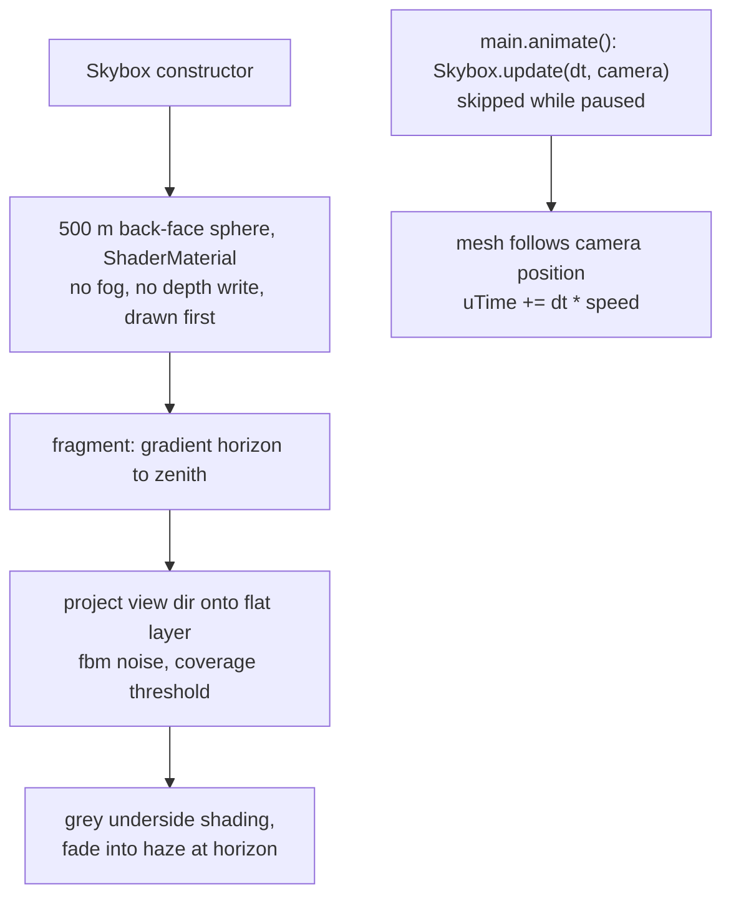
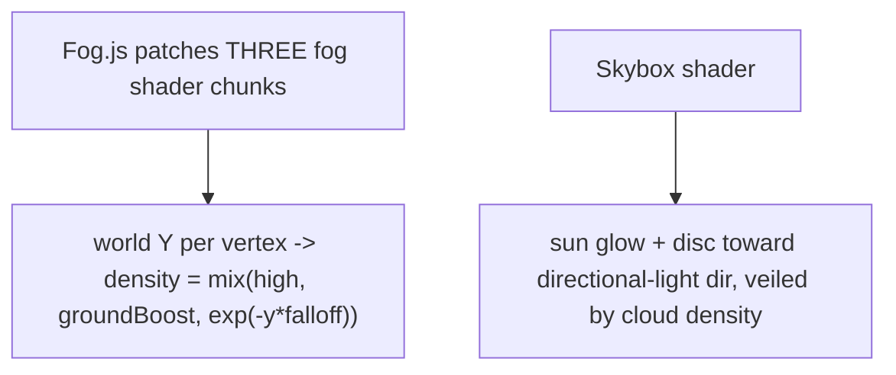
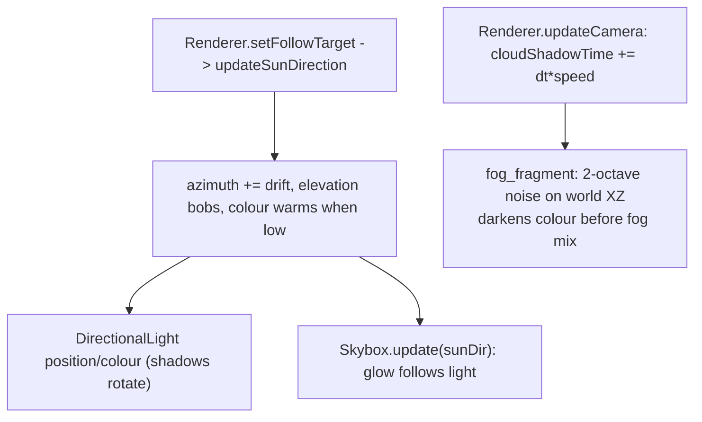

# 38 — Skybox (clouds)

Sources: `src/world/Skybox.js`, `src/config/world.ts` (`CLOUD_TUNING`), updated from `src/main.js`.

## Fog and sun

## Dynamic sun and cloud shadows

## Decisions

- **Decision:** Cloud shadows are a noise term in the global fog fragment chunk, not real shadow maps; shared `uCloudT` uniform injected by wrapping `Material.onBeforeCompile`.
  **Why:** Zero extra passes and covers every material (water, banks, trees) without editing each.
  **Alternatives:** Projected cloud texture on a light (spot-light cookie, not in three), per-material patches (many files).
- **Decision:** Sun drift is slow (~26 min per turn) with bounded elevation (30-50 deg).
  **Why:** Visible shadow movement without ever leaving the shadow camera's range or breaking the overcast mood.
- **Decision:** Height-layered fog via global ShaderChunk patch; sun is a veiled glow in the sky. No lightning.
  **Why:** Uniform fog looked flat; mist hugging the water gives depth while keeping treetops and towers readable. Overcast sky hides the sun disc mostly, so only glow shows.
  **Alternatives:** Per-material onBeforeCompile (more code), fog volume meshes (costly). Lightning was built and removed: the day is cloudy, not stormy.

- **Decision:** Procedural shader dome instead of 3D cloud meshes.
  **Why:** Mesh clouds looked lame and sat above the low FPV view; a dome fills the whole sky at any camera pitch and costs one draw call.
  **Alternatives:** Billboard sprites (need textures), low-poly puff meshes (tried, rejected).
- **Decision:** Horizon colour matches scene fog/background.
  **Why:** Distant scenery fades into the same haze, so there is no visible seam.
- **Decision:** Moody swamp look: desaturated grey-teal haze (`0x8ea7ad`) for sky, fog and background; coverage 0.68; dark cloud undersides; cloud layer projected close (offset 0.04) with a short horizon fade (0.09).
  **Why:** Matches the swampy river; low clouds read as hanging just above the treeline.
  **Alternatives:** Keep the bright blue sky (rejected as too cheerful for the setting).
- **Decision:** Water now receives the sun's shadow map (`receiveShadow = true`); cloud shadow strength raised 0.22 to 0.45.
  **Why:** Water never received shadows, so boat/reed/tree shadows were invisible where most of the screen is; 0.22 cloud darkening was imperceptible on teal water.
- **Decision:** Swamp water palette: deep `0x26402a` to shallow `0x5b6b3c` (murky olive), fresnel reflection grey-olive to overcast grey (was teal/cyan-blue).
  **Why:** The cyan sky reflection and teal base read as a clear lake, not a swampy river under cloud.
  **Alternatives:** Brown tannin water (too close to mud banks).
