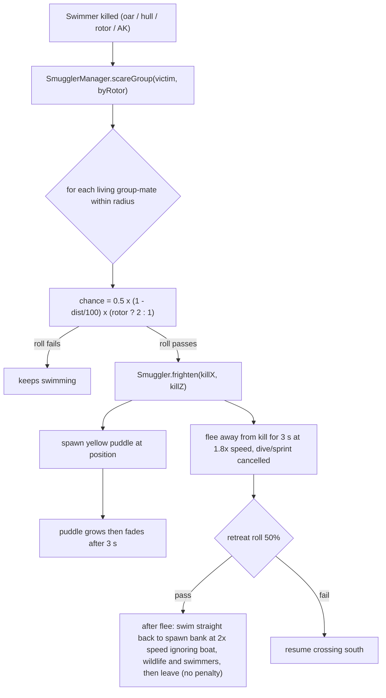

# Group fright

When a swimmer dies, living members of the same spawn wave (group) within 100 m may panic: they bolt away from the kill for a few seconds and leave a fading yellow puddle (same mechanism as the blood puddle).

## Decisions

- **Decision:** "Group" is the spawn wave (`groupId` = wave number). **Why:** that is what the player sees as a pack. **Alternatives:** proximity only (would scare unrelated swimmers).
- **Decision:** Chance is rolled once per group-mate per kill, linear falloff to 0 at the radius, doubled for propeller shreds (can exceed 1 near the kill, which just means certain). **Why:** matches the spec; shreds are the most gruesome kill.
- **Decision:** Fleeing is away from the kill point and ignores the usual southward drift for `VITE_FRIGHT_SECONDS`. A swimmer can be re-frightened by every later kill: the flee timer, flee direction and retreat roll are recalculated each time (a retreating swimmer can turn back to crossing, or start retreating). **Why:** avoids endless re-scares and lets them resume crossing afterwards.
- **Decision:** After fleeing, 50% of frightened swimmers retreat to the bank they spawned on at 2x swim speed and despawn on arrival. **Why:** a scared pack should thin out instead of all resuming the crossing. **Alternatives:** keep crossing (original behaviour).

Tunables (`src/config/difficulty.ts`): `VITE_FRIGHT_RADIUS` 100, `VITE_FRIGHT_CHANCE` 0.5, `VITE_FRIGHT_ROTOR_MULTIPLIER` 2, `VITE_FRIGHT_SECONDS` 3, `VITE_FRIGHT_SPEED_MULTIPLIER` 1.8., `VITE_FRIGHT_RETREAT_CHANCE` 0.5, `VITE_FRIGHT_RETREAT_SPEED` 2.
