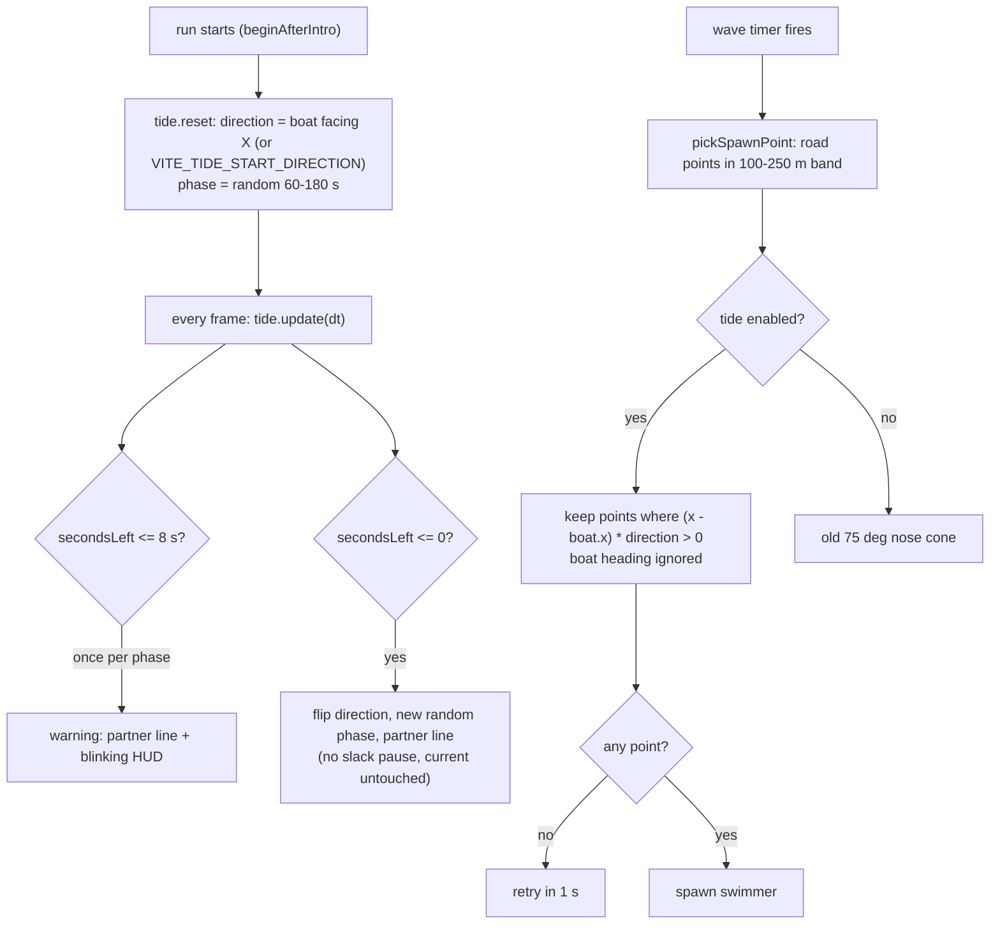

# 40 — Tide spawning

Source: `src/systems/TideSystem.ts`, `src/entities/SmugglerManager.js` (`pickSpawnPoint`), `src/config/world.ts` (`TIDE_TUNING`), `src/main.js` (indicator, partner lines), `src/style.css`.

## Logic

- Direction is along world X (the river axis). Swimmers already alive when the tide flips keep playing out; the dormant/despawn streaming rules clean up ones left behind.
- HUD: an arrow (projected through the camera so it points at the spawn side on screen) with seconds to the flip; blinks yellow during the warning.
- Knobs: `VITE_TIDE_ENABLED` / `?tide=0`, `VITE_TIDE_MIN_SECONDS` / `_MAX_SECONDS` (60/180; `?tideSeconds=N` sets both), `VITE_TIDE_WARNING_SECONDS` (8), `VITE_TIDE_START_DIRECTION` / `?tideStart=` (0).

## Decisions

- **Decision:** One-sided spawning that flips on a timer. **Why:** requested; spawning from both ends while circling a stuck swimmer made it impossible to reach both, and forward-only play was boring. **Alternatives:** nose-cone spawns (old; follows heading so never forces a turn).
- **Decision:** Phase length random 60-180 s, not scaled by rank. **Why:** requested ("fixed"); set min = max for an exact length. **Alternatives:** shorten with rank.
- **Decision:** No slack-water pause at the flip. **Why:** requested. **Alternatives:** 4 s spawn pause.
- **Decision:** The water current does not reverse. **Why:** requested; the tide is only a spawn rule. **Alternatives:** ease the river current on flip (changes boat handling).
