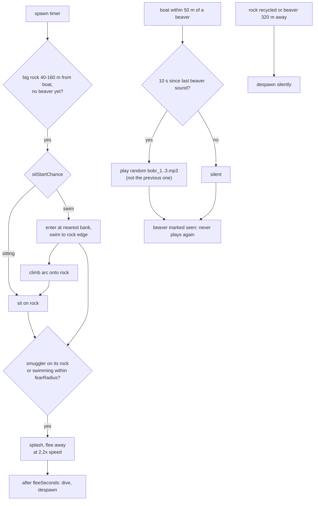

# 41 — Beavers

Sources: `src/entities/Beaver.js` (model), `src/entities/BeaverManager.js` (`BeaverActor`, `BeaverManager`), `src/config/beaver.ts` (`BEAVER_TUNING`), `src/systems/Audio.js` (`playBeaver`), `src/main.js`.

## Decisions

- Decision: beavers live in their own `BeaverManager`, not `WildlifeManager`. Why: birds and smugglers iterate `wildlifeManager.creatures` as prey/scare sources and the kill counters assume frog/snake. Alternatives: a third creature type there.
- Decision: beavers only fear smugglers (swimming nearby, or resting on their rock), not the boat. Why: requested behaviour. Alternatives: dive from the boat like frogs.
- Decision: the sound clips are optional files in `public/` (`bobr_1..3.mp3`) fetched at runtime. Why: the YouTube source was age-gated, so the clips are user-supplied; the game runs silently if they are removed.
- Decision: one beaver sound at most every 10 s across all beavers, random of 3 clips, never the same twice in a row, volume 0.2. Why: several beavers in range would otherwise spam. Alternatives: per-beaver cooldown; a second-sighting clip (dropped when the user supplied 3 clips).
- Decision: a beaver is marked seen the first time it enters range, whether or not the throttle let the sound play. Why: stationary boat next to several beavers would otherwise play one sound per beaver every 10 s. Alternatives: retry throttled beavers when the throttle ends (previous behaviour).
