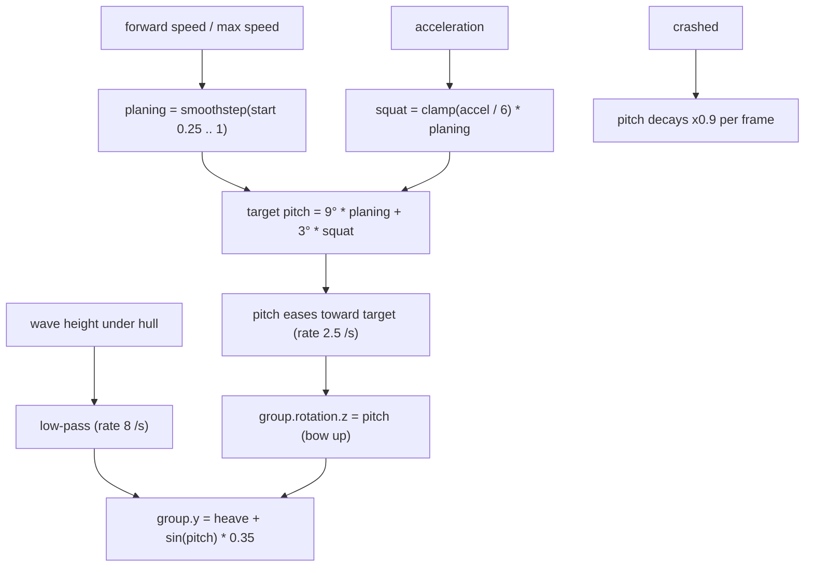

# 42 — Boat planing trim and smoothed wave riding

Sources: `src/entities/Boat.js` (`update`, `holdCrashedPose`, `reset`), `src/config/boat.ts`.

## Decisions

- **Decision:** pitch the whole boat group about its local Z, not just the hull. **Why:** motor, crew and oars must tilt with the tubes. **Alternatives:** hull only (crew would float).
- **Decision:** low-pass the wave height instead of removing the wave ride. **Why:** the `max(0, wave)` clamp made the hull snap up and down, which read as jumping. **Alternatives:** flat hull height (loses the sense of water).
- **Decision:** reversing gives no trim. **Why:** an inflatable only planes forward. **Alternatives:** slight stern-up.
- **Decision:** bow lift of 9° at top speed with +3° while accelerating. **Why:** visible from the drone view without clipping the bow cones. **Alternatives:** larger angles (look cartoonish).
- **Decision:** base ride height lowered from 0.16 to 0.04 (`VITE_BOAT_RIDE_HEIGHT`). **Why:** boat looked perched on the water. **Alternatives:** lower the tubes in the model (touches every attachment).
- **Decision:** the boat samples `riverSwellAt` (exact CPU copy of the shader swell) instead of its own sin/cos. **Why:** the old formula did not match the drawn water, so the hull floated above or sank into it and the `max(0, wave)` clamp made it jump. **Alternatives:** keep the approximation and fudge the height.
- **Decision:** bow spray and hull foam reuse the shared particle pool. **Why:** no new draw calls. **Alternatives:** dedicated foam decals or a water-shader wake (see #18 WebGPU water).
- **Decision:** wake ripples are a 48-slot uniform array of expanding rings in the existing water shader, not WebGPU compute water (#18). **Why:** works on the WebGL path today, one shader loop, no new passes. **Alternatives:** WebGPU compute wake/foam (still TODO #18); decal meshes behind the boat.
- **Decision:** water particles are 0.025x size and 200x count, scattered randomly (jittered spawn, omnidirectional kick) rather than in streams, wake emitted as a random fan across the stern instead of a 3-point V. **Why:** large blobs looked like grey clouds. **Alternatives:** smaller sphere geometry (same effect, less tunable).
- **Decision:** at speed the hull follows less of the swell (`VITE_BOAT_WAVE_FOLLOW_AT_SPEED` 0.35 of heave/pitch at top speed), wave pitch is low-passed (`VITE_BOAT_WAVE_PITCH_RESPONSE` 5/s), heave response 8 -> 6, and banking roll uses a frame-rate-independent filter. **Why:** crossing short chop at top speed made the hull buzz. **Alternatives:** fewer/smaller waves (changes the water look).
