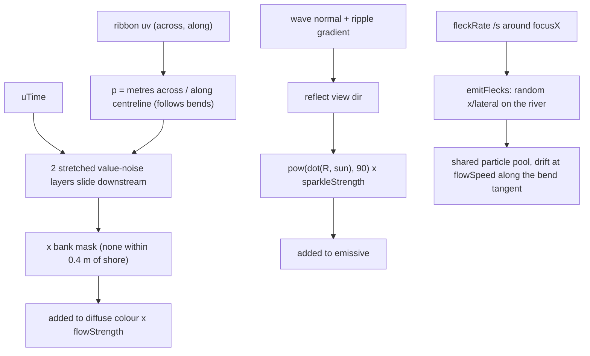

# 43 — WebGL river water: flow streaks and glints

Sources: `src/world/River.js` (`createWater`, `emitFlecks`), `src/config/water.ts`.

## Decisions

- **Decision:** ambient foam flecks drift at `flowSpeed` along the bend tangent, not at `river.current`. **Why:** `current` is ~0.2 m/s and would look static; this matches the streaks. **Alternatives:** scale `current` up (would change gameplay drift).
- **Decision:** flecks reuse the shared particle pool. **Why:** no new draw calls. **Alternatives:** a dedicated InstancedMesh (more control, more cost).

- **Decision:** streaks are laid out in (across, along) metres from the ribbon UVs. **Why:** the river bends, so world-X scrolling would not follow the current. **Alternatives:** world-space scroll along `current` (wrong on bends).
- **Decision:** extend the existing patched `MeshStandardMaterial` rather than add WebGPU/compute. **Why:** works on the WebGL path today; WebGPU stays under #18. **Alternatives:** full `ShaderMaterial` (loses lighting/fog/shadows).
- **Decision:** glint uses a fixed sun-ish direction, not the live drifting sun. **Why:** no uniform plumbing needed; subtle. **Alternatives:** feed the sun vector from Skybox.
- **Decision:** South beach slopes down 0.35 m into the water and the water mesh overlaps each bank by 1.6 m (was 0.6). **Why:** the shoreline-drop sank the water edge below the flat sand, leaving a visible gap/pale line before the bank. **Result:** water laps up the sloped sand and the waterline is a natural intersection. **Alternatives:** raise the water edge (z-fights with flat sand).
