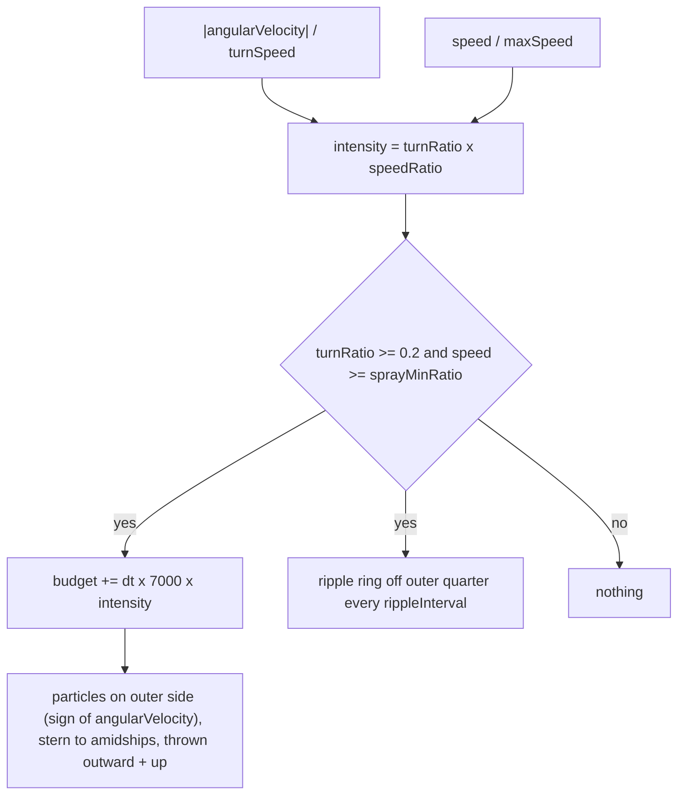

# 44 — Turn spray

Sources: `src/entities/Boat.js` (`emitTurnSpray`, `emitBowSpray`), `src/world/River.js` (`emitEngineWake`, particle update), `src/config/boat.ts`.

## Decisions

- **Decision:** spray comes from the outer side only. **Why:** the hull skids outward in a carve, so that side digs in. **Alternatives:** both sides (reads as straight-line spray).
- **Decision:** rate scales with turn rate x speed. **Why:** a slow or gentle turn shouldn't spray. **Alternatives:** a fixed burst above a threshold.
- **Decision:** reuses the shared particle pool and ripple slots. **Why:** no new draw calls. **Alternatives:** a dedicated emitter.
- **Decision:** all boat particles (bow, hull, turn, stern wake) are emitted as rate x dt, spread along the path travelled this frame and back-dated (`preAge`). **Why:** the old wake emitted a fixed count per call, so amount depended on frame rate and the trail was a row of clumps. **Alternatives:** per-frame bursts (janky).
- **Decision:** spray inherits ~0.9 of hull velocity and decays with drag (`VITE_BOAT_SPRAY_DRAG` 2.5/s). **Why:** it leaves the hull with the boat and falls behind naturally. **Alternatives:** scripted slow velocity.
- **Decision:** particles are ~20x bigger and ~100x fewer (`VITE_PARTICLE_SCALE` 0.2, `VITE_PARTICLE_DENSITY` 1; wake `VITE_BOAT_WAKE_RATE` 1500/s, bow `VITE_BOAT_SPRAY_RATE` 2500/s, splashes x`VITE_SPLASH_DENSITY` 6). **Why:** 5 mm sub-pixel spheres sparkled, and ~40k live wake particles overran the pool and recycled visible ones. **Alternatives:** soft sprite quads or a foam-trail texture (not done yet).
- **Decision:** particles fade in/out with smoothstep, ease their growth, and land on the drawn swell (`riverSwellAt`) with strong horizontal drag. **Why:** no pop at spawn/death; foam bobs with waves. **Alternatives:** flat y clamp.
- **Decision:** ripple timer carries over remainder instead of resetting. **Why:** spacing snapped to frame boundaries.
- **Decision:** particles are billboarded soft discs (vertex-shader billboard on the instanced plane, radial alpha falloff), and `VITE_PARTICLE_SCALE` dropped to 0.2. **Why:** faceted 0.4 m spheres read as hard white hexagons. **Alternatives:** keep spheres, only shrink them.
- **Decision:** wake ripple height and foam are boosted in the water shader (`VITE_WATER_RIPPLE_GAIN` 2.5, `VITE_WATER_WAKE_FOAM_GAIN` 1.8). **Why:** the shader wake looked best but too faint; it carries the wake while particles add spray. **Alternatives:** more particles (janky).
